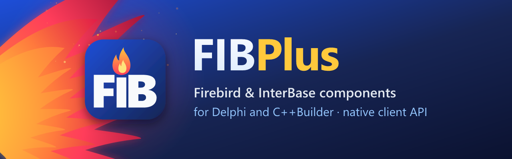

  

FIBPlus is a fast, easy-to-use component library for Delphi and C++Builder that works with Firebird and InterBase directly through the native client API, with no extra data access layers in between.

It is built for database application developers and has grown from their real-world needs: every component, method and property is designed to solve the tasks you face every day.

## 📚 Documentation

See the [documentation](Docs/README.md): a guide to features such as transactions and timeouts, and a reference of classes, properties, methods and events.

The [samples](Samples/README.md) are small applications that show one feature each, with a demo database.

## 📦 Installation

FIBPlus 7.9 supports Delphi 6 to 13. The packages are in the `Packages` folder:

| Delphi | Open |
|--------|------|
| 10 Seattle to 13 Florence | `FIBPlus_Dxx.groupproj`: D23 (10), D24 (10.1), D25 (10.2), D26 (10.3), D27 (10.4), D28 (11), D29 (12), D37 (13) |
| XE to XE8 | `FIBPlus_XE.groupproj` (XE), `FIBPlus_XEn.groupproj` (XE2 to XE8, `n` is 2 to 8) |
| 6 to 2010 | `FIBPlusNN` and `FIBPlusEditorsNN`, where `NN` is 6, 7, 2005, 2006, 2007, 2009 or 2010 |

| Package | Type | Purpose |
|---------|------|---------|
| `FIBPlus*` | runtime | Components, required by the other packages; before Delphi 10 Seattle it also registers them in the Tool Palette |
| `DclFIBPlus_Dxx` | design time | Tool Palette registration, Delphi 10 Seattle and later |
| `FIBPlusEditors*` | design time | Property and component editors, IDE login dialog |
| `FIBPlusFMX` | runtime | FireMonkey login dialog (`FIB_FMX_DBLoginDlg`), Delphi 13 |

### 🛠️ Steps

1. Open the project group or the packages and select the **Win32** platform.
2. Build `FIBPlus*` first (it is a never-build package), then the other packages; in a project group **Build All** does this.
3. Install `DclFIBPlus_Dxx` (before Delphi 10 Seattle: `FIBPlus*`) and `FIBPlusEditors*`.
4. In the library options of the IDE, add the `Source` folder to the **Library path** of every target platform you use.

### 📝 Notes

- The packages are for the 32-bit IDE. For the 64-bit IDE of Delphi 12.3 and later, use FIBPlus 8 (the `master` branch).
- Build `FIBPlus*` and `FIBPlusFMX` for other platforms only if your application uses runtime packages.
- From Delphi 2007, DCUs go to `$(BDSCOMMONDIR)\Dcu\FIBPlus\$(Platform)\$(Config)`. Add this folder to the library path before `Source` to avoid recompiling FIBPlus in each project.
- **Language**: messages are in English. For Russian, copy `Resources\Russian\FIB_Messages.inc` over `Source\FIB_MESSAGES.INC` and rebuild.

## ❤️ Support FIBPlus

Keeping FIBPlus alive takes real time: fixing bugs, reviewing patches and adapting the code to every new Delphi and Firebird release. If FIBPlus powers your apps, please consider [becoming a backer](Docs/SPONSORS.md) — monthly or one-time, every contribution helps.

## ⚠️ Disclaimer

*This repository is an attempt to keep alive one of the best suite of components that seems to be abandoned by Devrace, without pretending to any copyrights. Initial source code was taken from public forums.*

*The goal of this project is to collect patches, fix bugs, adjust code to latest versions of Delphi, improve functionality by adding new features.*
