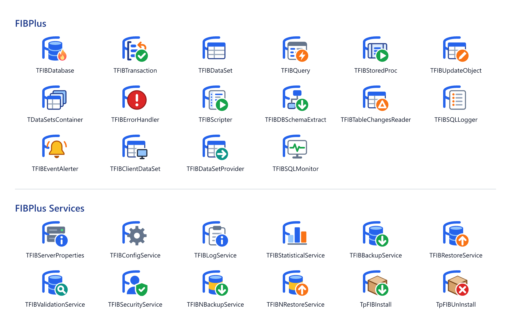

#  FIBPlus Library

FIBPlus is a fast, easy-to-use component library for Delphi and C++Builder that works with Firebird and InterBase directly through the native client API, with no extra data access layers in between.

It is built for database application developers and has grown from their real-world needs: every component, method and property is designed to solve the tasks you face every day.

  <a href="Docs/README.md"><picture>
    <source media="(prefers-color-scheme: dark)" srcset="Docs/images/palette-dark.png">
    
  </picture></a>

## 📚 Documentation

See the [documentation](Docs/README.md): a guide to features such as transactions and timeouts, and a reference of classes, properties, methods and events.

## 📦 Installation

The `Packages` folder contains one project group, `FIB.groupproj`, for Delphi 10.4 Sydney and later, and a project group `FIBPlus_Dxx.groupproj` for each older version, where `xx` is the product version:

| Delphi | Project group |
|--------|---------------|
| 13 Florence, 12 Athens, 11 Alexandria, 10.4 Sydney | `FIB.groupproj` |
| 10.3 Rio | `FIBPlus_D26.groupproj` |
| 10.2 Tokyo | `FIBPlus_D25.groupproj` |
| 10.1 Berlin | `FIBPlus_D24.groupproj` |
| 10 Seattle | `FIBPlus_D23.groupproj` |

FIBPlus 8 supports Delphi 2009 and later; use 7.9.x for Delphi 6 to 2007. The packages of Delphi 2009 to XE8 are also in `Packages` (project groups only for XE2 to XE5 and XE7); they are not tested with 8.0.

For Delphi 10.4 and later each package is one `.dpk` for all versions: `{$LIBSUFFIX AUTO}` gives the BPL the version suffix, e.g. `FIB370.bpl` for Delphi 13 and `FIB280.bpl` for Delphi 11. The groups contain these packages:

| Package | Type | Purpose |
|---------|------|---------|
| `FIB` (`FIBPlus_Dxx` before Delphi 10.4) | runtime | Components, required by the other packages |
| `dclFIB` (`dclFIB_Dxx` before Delphi 10.4) | design time | Registers the components in the Tool Palette; property and component editors, VCL login dialog for the IDE |
| `dclFIBTools` | design time, optional | **Tools > FIBPlus** menu with Preferences and About, closes the design-time connections before the program runs from the IDE; Delphi 10.4 and later |
| `FIBFMX` | runtime | FireMonkey login dialog (`FIB_FMX_DBLoginDlg`); Delphi 10.4 and later |

### 🛠️ Steps

1. Open the project group for your Delphi version.
2. In Project Manager, select the **Win32** platform for all packages (see below for the 64-bit IDE).
3. Right-click `FIB` (`FIBPlus_Dxx`) and choose **Build**. It is a never-build package (`{$IMPLICITBUILD OFF}`), so it must be built explicitly before the design packages. Skipping this step causes *E2225 Never-build package 'FIB' must be recompiled*.
4. Right-click `dclFIB` (`dclFIB_Dxx`), choose **Build**, then **Install**.
5. Optional, Delphi 10.4 and later: right-click `dclFIBTools`, choose **Build**, then **Install**.
6. In **Tools > Options > Language > Delphi > Library**, add the `Source` folder to the **Library path** for every target platform you use (Win32, Win64, ...).

**64-bit IDE** (Delphi 12.3 and 13): `dclFIB` and `dclFIBTools` also have a Win64 platform. Select **Windows 64-bit** in step 2, build `FIB`, `dclFIB` and `dclFIBTools` (output in `BplWin64` and `DcpWin64`), then install `dclFIB` and `dclFIBTools` from `BplWin64` in the 64-bit IDE. `BplWin64` must be on the PATH of the 64-bit IDE. Win64x (Modern C++) is not what the 64-bit IDE loads.

The runtime package itself does not need to be installed. The design packages exist only for the IDE platform (Win32, or Win64 for the 64-bit IDE), as the IDE loads them; for Win64 applications it is enough to set the library path, as in step 6. Build `FIB` for Win64 only if your application is built with runtime packages. `FIBFMX` is needed only by FireMonkey applications built with runtime packages; otherwise add `FIB_FMX_DBLoginDlg` to the uses clause.

The packages write their DCU files to `$(BDSCOMMONDIR)\Dcu\FIBPlus\$(Platform)\$(Config)`, e.g. `C:\Users\Public\Documents\Embarcadero\Studio\37.0\Dcu\FIBPlus\Win32\Release`. This folder is separate for each Delphi version, so several versions installed on the same machine don't overwrite each other's DCU files. Adding this folder to the library path, before `Source`, is optional and only avoids recompiling FIBPlus in each project; `Source` stays needed for the form and resource files.

**Russian messages**: most messages of the errors raised by FIBPlus itself (`EFIBClientError`) come from the table in `Source\FIB_MESSAGES.INC`, in English; a few, such as those of array fields, are fixed English text. For Russian, copy `Resources\Russian\FIB_Messages.inc` over `Source\FIB_MESSAGES.INC` and rebuild the packages and your application. Server error messages come from the server and are not affected.

## ❤️ Support FIBPlus

Keeping FIBPlus alive takes real time: fixing bugs, reviewing patches and adapting the code to every new Delphi and Firebird release. If FIBPlus powers your apps, please consider [becoming a backer](Docs/SPONSORS.md) — monthly or one-time, every contribution helps.

## ⚠️ Disclaimer

*This repository is an attempt to keep alive one of the best suite of components that seems to be abandoned by Devrace, without pretending to any copyrights. Initial source code was taken from public forums.*

*The goal of this project is to collect patches, fix bugs, adjust code to latest versions of Delphi, improve functionality by adding new features.*
